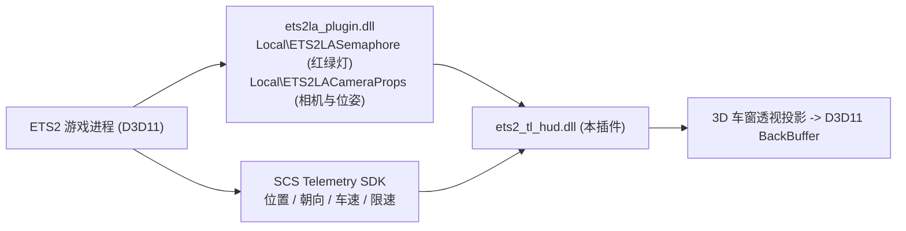

# ETS2 车窗红绿灯 HUD 巡航辅助

直接运行于《欧洲卡车模拟 2》(ETS2 1.62) 内部的 **原生 D3D11 车窗 3D 全息 HUD 插件 (`ets2_tl_hud.dll`)**：读取本车前方最近红绿灯的真实状态与剩余倒计时，以 3D 透视平面投射在驾驶室前挡风玻璃下沿（避开左侧 HUD GPS 导航），支持独占全屏与无边框模式，无需打开外部叠加窗口。

## 核心特性

- 🪟 **驾驶室 3D 车窗投影 (`window_3d`)**：固定于前挡风玻璃下沿偏中位置（默认避开左侧地图 HUD），转头看后视镜时随车窗真实透视位移；切换车外视角或暂停时自动隐藏。支持卡车与 **Coaches DLC 客车**（双层大巴/长途客车），切车自动重校准驾驶室基准点并支持**按车型独立保存**车窗微调位置（`[Vehicle.<id>]`）。
- ⚡ **全屏/无边框通用**：通过 Hook 游戏 D3D11 `Present` 直接渲染进游戏画面，零窗口合成延迟、不占额外桌面焦点。
- 🚦 **精简放大 HUD 界面**：
  - 左侧放大三灯信号柱（带荧光光晕，支持红 / 红黄 / 绿 / 黄 / 黄闪及收费站/铁路道口道闸）
  - 左上大号纯数字倒计时（< 5 秒精确到 0.1 秒）
  - 右上大号停车线距离（`m`）
  - 底部彩色状态竖条 + 放大单行巡航建议（保持车速 / 加速通过 / 绿波减速 / 减速停车 / 紧急制动）
- 🔔 **危险蜂鸣提醒**：红/黄灯或道闸未开需要刹车时提示。
- 🎛️ **游戏内实时热键微调**：按快捷键实时调整位置并自动写入 `ets2_tl_hud.ini`。

## 架构说明



## 安装与部署

1. 确保游戏插件目录 `Euro Truck Simulator 2\bin\win_x64\plugins\` 中已存在 **`ets2la_plugin.dll`**（1.62 版）。
2. 双击或运行 **`native\install.bat`**（会自动读取 Steam 注册表与 `libraryfolders.vdf` 探测游戏路径，并在缺失 `plugins` 目录时自动创建）：
   - 默认安装：`native\install.bat`（自动保留你已调好的 `ets2_tl_hud.ini`）
   - 手动指定游戏目录：`native\install.bat "D:\Games\Euro Truck Simulator 2"`
   - 常用参数：`--rebuild`（强制重新编译后安装）、`--reset-ini`（备份旧配置为 `.ini.bak` 并恢复默认配置）、`--uninstall`（卸载插件）、`--silent`（静默执行不暂停）、`--help`（查看全部选项）
3. 启动游戏，在弹出「请求使用高级 SDK 特性」提示时点击 **确定** 即可。

> 若 `plugins\` 中仍留有旧版配置，也可在游戏内按 `Ctrl + F10` 重载。

## 游戏内微调热键

仅在游戏窗口处于前台时生效，调节结果自动保存至 `ets2_tl_hud.ini`：

| 快捷键 | 3D 车窗模式作用 | 2D 固定模式作用 |
|---|---|---|
| `Ctrl + ← / →` | 左右偏移 `offset_x` (±0.010 m，按住 `Shift` 为 ±0.002 m) | 水平位置 `screen_x` |
| `Ctrl + ↑ / ↓` | 上下偏移 `offset_y` (±0.010 m，按住 `Shift` 为 ±0.002 m) | 垂直位置 `screen_y` |
| `Ctrl + PageUp / PageDown` | 前后景深 `offset_z` (±0.020 m) | 面板宽度 `screen_width` |
| `Ctrl + F8` | 切换 `window_3d`（3D车窗） / `screen_2d`（2D固定） | 同左 |
| `Ctrl + F9` | 开关演示预览模式（无红绿灯时可随时开启调整位置） | 同左 |
| `Ctrl + F10` | 热重载 `ets2_tl_hud.ini` 并重新校准驾驶室基准点 | 同左 |
| `Ctrl + F11` | 临时隐藏 / 显示 HUD | 同左 |

## 绿框默认参数 (`native/ets2_tl_hud.ini`)

- `mode = window_3d`
- `offset_x = 0.160`, `offset_y = -0.245`, `offset_z = -1.390`
- `panel_width = 0.420`, `panel_height = 0.155`, `tilt_deg = 8.0`
- `bg_opacity = 0.28`（设为 `0.0` 为纯文字无底框投影），`hud_alpha = 0.94`

## 从源码编译 (MinGW-w64)

环境：`C:\mingw64\bin`（GCC/G++ 8.1+，含 Windows SDK `d3d11` / `d3dcompiler` / `gdiplus`）：

```bat
cd native
build.bat
```

生成产物为 `native\dist\ets2_tl_hud.dll`（静态链接 C/C++ 运行时与 winpthread，仅依赖系统 DLL）。

## 辅助脚本（Python）

- **数据诊断工具** `probe.py`：在游戏中停在红绿灯前运行 `python probe.py`，查看共享内存里信号灯纵向/横向距离、状态码与选中结果，便于调优 `[Selection]` 或 `[StateCodes]`。
- **桌面预览版** `main.py --demo`：已同步更新为精简放大样式，可在不开游戏时快速预览。

## 目录结构

```
native/
  src/
    types.hpp          数据结构与配置定义
    config.hpp/.cpp    UTF-8 INI 读写与就地保存（保留注释）
    shm_reader.hpp/.cpp 命名共享内存读取（带节流自动重连）
    logic.hpp/.cpp     信号灯解析、选灯与巡航建议
    hud_math.hpp/.cpp  驾驶室基准自校准与 3D 车窗透视投影
    hud_painter.hpp/.cpp GDI+ 760x280 预乘 Alpha 放大 HUD 渲染
    d3d11_hook.hpp/.cpp MinHook D3D11 Present/ResizeBuffers 渲染管线
    plugin_main.cpp    SCS Telemetry SDK 入口、热键与蜂鸣提醒
    ets2_tl_hud.def    DLL 精确导出表
  ets2_tl_hud.ini      默认配置文件
  build.bat            MinGW-w64 编译脚本
  install.bat          一键部署到 ETS2 plugins 目录
  dist/ets2_tl_hud.dll 编译产物
src/                   Python 辅助版源码
probe.py               共享内存诊断工具
```

> [!NOTE]
> 本插件仅只读访问游戏共享内存与遥测通道，不修改游戏内存，也不发送任何模拟输入。多人联机（TruckersMP）对 SDK 插件的限制请自行确认。
