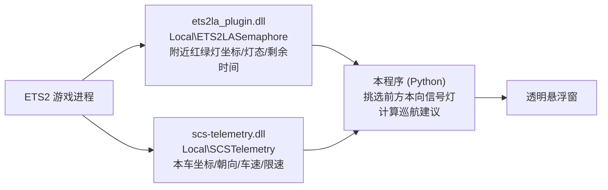

# ETS2 红绿灯巡航辅助

读取本车前方最近红绿灯的**真实游戏数据**（灯态 + 剩余秒数），在游戏画面上叠加透明悬浮窗，提供：

- 🚦 **红绿灯状态**：红 / 红黄 / 绿 / 黄 / 黄闪，以及收费站、铁路道口的道闸状态
- ⏱ **倒计时**：当前灯态还剩几秒（低于 5 秒时精确到 0.1 秒）
- 📏 **到停车线的距离**、当前车速、道路限速
- 🧭 **巡航建议**：保持车速通过 / 加速至 X km/h 通过 / 减速至 X km/h 绿波通过 / 减速停车 / 紧急制动
- 🔔 **蜂鸣提醒**：需要停车或紧急制动时提醒

适配游戏版本：**ETS2 1.62**

## 工作原理（不需要截屏，资源占用极低）



- 红绿灯数据来自 ETS2LA 项目的 `ets2la_plugin.dll`（https://gitlab.com/ETS2LA/ets2la_plugin），它在游戏内部读取附近信号灯，并写入共享内存 `Local\ETS2LASemaphore`。
- 本车数据来自 `scs-telemetry.dll`（官方 SDK 遥测插件）。
- 本程序每秒只读取 10 次、每次不到 4 KB 的共享内存，CPU 占用几乎可以忽略。

## 安装

1. **游戏插件**（你的电脑上已安装，位于 `Euro Truck Simulator 2\bin\win_x64\plugins\`）：
   - `ets2la_plugin.dll`
   - `scs-telemetry.dll`

   如果以后被删除，可以通过 ETS2LA 安装程序重新安装，或从上面的仓库获取。游戏启动时会弹出「SDK 插件」提示，点「确定」即可。
2. **Python 3.9+**，安装依赖：
   ```
   pip install -r requirements.txt
   ```
3. 游戏画面设置改为 **窗口化全屏 / 无边框窗口**（独占全屏下外部悬浮窗不可见）。

## 使用

| 操作 | 方法 |
|---|---|
| 启动 | 双击 `start.bat`，或运行 `python main.py` |
| 无游戏时预览效果 | `python main.py --demo` |
| 调整悬浮窗位置 | 右键托盘图标 →「解锁位置」→ 拖动 →「锁定位置并保存」 |
| 退出 | 右键托盘图标 →「退出」 |
| 诊断数据 | 游戏中停在红绿灯前，运行 `python probe.py` |

所有参数都在 [config.ini](config.ini) 中，里面有中文注释。

## 巡航建议逻辑

设 d = 到停车线距离，v = 车速，t = 当前灯态剩余时间，到达时间 ETA = d / v：

| 灯态 | 条件 | 建议 |
|---|---|---|
| 绿灯 | ETA ≤ t | 保持车速通过 |
| 绿灯 | 以 d/t 的速度能通过，且不超限速、所需加速度可达 | 加速至 d/t |
| 绿灯 | 以上都不满足，且能安全停下 | 准备减速停车 |
| 黄灯 | ETA ≤ t | 保持车速通过 |
| 黄灯 | 停车所需减速度 v²/2d ≤ 最大减速度 | 减速停车 |
| 红灯 | ETA ≥ 到绿灯的时间 | 保持车速，抵达时为绿灯 |
| 红灯 | d / 到绿灯时间 ≥ 最低绿波速度 | 减速至该速度，绿波通过（不用停车） |
| 红灯 | 否则 | 减速停车 / 紧急制动 |

## 常见问题

**悬浮窗显示「未检测到 ets2la_plugin 红绿灯数据」**
检查 `ets2la_plugin.dll` 是否在 plugins 目录、游戏启动时有没有被加载；插件版本必须与游戏版本对应（目录里的 `ets2la_1.62` 文件就是版本标记）。游戏更新后需要等 ETS2LA 发布新版插件。

**选中的灯不对 / 一直显示「前方无红绿灯」**
游戏中停在红绿灯前运行 `python probe.py`，查看每个信号灯的「纵向 / 横向 / 高差 / 朝向点积」：
- 本方向的灯，朝向点积如果总是接近 +1（或总是接近 −1），可以把 `facing_mode` 设为 `1`（或 `-1`），排除对向的灯；
- 灯态码和实际颜色对不上时，修改 `[StateCodes]`；
- 坐标明显偏差 512 的整数倍时，检查 `sector_size`。

**倒计时与游戏不同步**
`time_left` 由插件直接给出，等于游戏内部的计时；游戏暂停时悬浮窗会显示「游戏已暂停」。

## 文件结构

```
main.py            主程序（悬浮窗 + 控制循环）
probe.py           诊断工具
config.ini         配置
start.bat          一键启动
src/shm.py         Windows 共享内存只读访问
src/telemetry.py   读取本车遥测
src/semaphores.py  解析红绿灯数据，挑选前方目标灯
src/advisor.py     巡航建议算法
src/sources.py     游戏数据源 / 演示数据源
src/overlay.py     PyQt5 透明悬浮窗
```

> [!NOTE]
> 本工具只读取数据、不修改游戏，也不会向游戏发送任何输入。多人联机（TruckersMP）对 SDK 插件的政策请自行确认。
